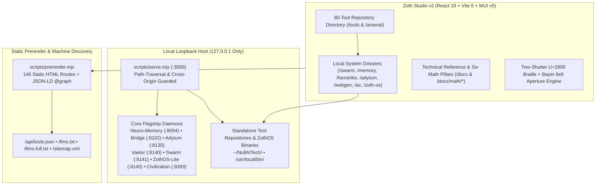

<div align="center">
  
</div>

# Zoth Studio v2

**Local-First Sovereign Agent Workstation, Desktop Loopback Host & 80-Tool Repository Index**

[](#tool-registry--cadre-index-80-entries)
[](#build-prerender--verification-suite)
[](#system-overview--architectural-model)
[](#procedural-aperture-intros--dual-theme-design)
[](LICENSE)

Live Reference & Repository Directory: **[https://zoth.nullai.tech](https://zoth.nullai.tech)**  
Primary Repositories: **[NullAITech/zoth-studio-v2](https://github.com/NullAITech/zoth-studio-v2)** • **[1nc0gn30/zoth-studio-v2](https://github.com/1nc0gn30/zoth-studio-v2)**

---

## System Overview & Architectural Model

**Zoth Studio v2** serves two distinct, complementary roles across the NullAI and ZothOS ecosystem:

1. **Public Architectural Reference & Repository Index (`https://zoth.nullai.tech`)**:
   Most sovereign security, OSINT, PTY multiplexing, neuromorphic memory, and hardware tools require real Linux sockets, local file-system sandboxes, USB/ADB bridges, or local GPU runtimes that cannot execute honestly inside a public static browser tab. Rather than shipping simulated browser widgets on the public web, `zoth.nullai.tech` provides high-contrast architectural dossiers, verified `git clone` instructions, exact loopback port assignments, CLI/MCP specifications, and release packages so operators can run every tool genuinely on local hardware.
2. **Local Desktop Host & Loopback Supervisor (`127.0.0.1:3000` on ZothOS / Linux / macOS / Windows)**:
   When cloned locally or installed via the native desktop bundle, `serve.mjs` and the Studio supervisor coordinate **80 registered tools** across unique loopback ports (`127.0.0.1:5173`–`127.0.0.1:9995`), connecting local CLI binaries, Model Context Protocol (MCP) servers, STDP memory (`:8094`), Vaelor DAG L1 (`:8140`), Swarm Multiplexer (`:8141`), ZothOS-Lite (`:8145`), Zoth Obsidian Tracker (`:8151`), Zoth X Connector (`:8152`), and Zoth Civilization (`:9393`) with strict origin checks and zero cloud telemetry.

---

## Quickstart (Local Clone & Desktop Execution)

```bash
# 1. Clone the Zoth Studio v2 repository
git clone https://github.com/NullAITech/zoth-studio-v2.git
cd zoth-studio-v2

# 2. Install dependencies
npm install

# 3. Build production bundle + prerender all 146 static HTML routes & sitemap.xml
npm run build

# 4. Run the full integrity, ground-truth math/crypto, and headless route verification suite
npm test

# 5. Start the local loopback workstation server on http://127.0.0.1:3000
node scripts/serve.mjs
```

For development with Vite HMR:

```bash
npm run dev
```

---

## Cross-Platform Desktop Releases (`v2.2.0`)

Prebuilt desktop bundles and standalone binaries are published on [**GitHub Releases (`v2.2.0`)**](https://github.com/NullAITech/zoth-studio-v2/releases/tag/v2.2.0) and verified against [`SHA256SUMS.txt`](https://github.com/NullAITech/zoth-studio-v2/releases/download/v2.2.0/SHA256SUMS.txt):

| Platform | Architecture | Artifact | Download |
| :--- | :--- | :--- | :--- |
| **Linux** | Debian / Ubuntu / ZothOS (`amd64`) | Debian Package (`.deb`) | [`zoth-studio_2.1.0_amd64.deb`](https://github.com/NullAITech/zoth-studio-v2/releases/download/v2.2.0/zoth-studio_2.1.0_amd64.deb) |
| **Linux** | Universal (`x86_64`) | AppImage (`.AppImage`) | [`Zoth_Studio-v2.2.0-x86_64.AppImage`](https://github.com/NullAITech/zoth-studio-v2/releases/download/v2.2.0/Zoth_Studio-v2.2.0-x86_64.AppImage) |
| **Linux** | Universal (`x86_64`) | Self-Extracting Installer (`.run`) | [`zoth-studio-v2.2.0-linux-x86_64.run`](https://github.com/NullAITech/zoth-studio-v2/releases/download/v2.2.0/zoth-studio-v2.2.0-linux-x86_64.run) |
| **Linux** | Universal (`x86_64`) | Native ELF64 Binary | [`zoth-studio-linux-x86_64`](https://github.com/NullAITech/zoth-studio-v2/releases/download/v2.2.0/zoth-studio-linux-x86_64) |
| **macOS** | Universal (`arm64` + `x86_64`) | Application Bundle (`.zip`) | [`Zoth_Studio-v2.2.0-macOS-universal.zip`](https://github.com/NullAITech/zoth-studio-v2/releases/download/v2.2.0/Zoth_Studio-v2.2.0-macOS-universal.zip) |
| **macOS** | Apple Silicon (`arm64`) | Native Mach-O Binary | [`ZothStudio-macos-arm64`](https://github.com/NullAITech/zoth-studio-v2/releases/download/v2.2.0/ZothStudio-macos-arm64) |
| **Windows** | Windows 10 / 11 (`x86_64`) | Self-Extracting Setup (`.exe`) | [`Zoth_Studio-v2.2.0-windows-x86_64-setup.exe`](https://github.com/NullAITech/zoth-studio-v2/releases/download/v2.2.0/Zoth_Studio-v2.2.0-windows-x86_64-setup.exe) |
| **Windows** | Windows 10 / 11 (`x86_64`) | Native PE64 Executable (`.exe`) | [`ZothStudio-windows-x86_64.exe`](https://github.com/NullAITech/zoth-studio-v2/releases/download/v2.2.0/ZothStudio-windows-x86_64.exe) |

---

## Procedural Aperture Intros & Dual-Theme Design

### Two-Shutter Physical Aperture Choreography (`src/motion/`)
- **`IntroDirector.jsx`**: Implements a physical two-shutter horizontal aperture split (`0%–50%` upper shutter + `50%–100%` lower shutter). The upper shutter houses the route index strip and procedural Braille stage strictly above the 50% seam; the lower shutter houses the category kicker, editorial serif title, hairline progress rule, and `Enter ESC` control strictly below the seam so the split line never bisects typography.
- **`AsciiBrailleDitherEngine.jsx`**: Zero-dependency 60fps 2×4 sub-pixel Unicode Braille (`U+2800`–`U+28FF`) + Ordered Bayer 8×8 dithering canvas rendering six procedural SDF geometries (`astrolabe`, `shield`, `lattice`, `synapse`, `radar`, `quorum`) with `220ms` glyph decode.
- **`routeIntros.js`**: Maps every primary showcase, reference route, and `/tools/:toolId` dossier to deterministic geometry, index numerals, and theme-calibrated accent tokens (`ACCENTS` for Dark Mode and `ACCENTS_LIGHT` for Light Mode), using `seenGroupKey` so consecutive `/tools/*` transitions remain instantaneous after initial group entry.
- **Accessibility & Operator Control**: Respects `prefers-reduced-motion: reduce`, skips automatically for headless crawlers, supports `?intro=0` bypass or `?intro=1` replay, and dismisses immediately on `ESC` or click.

### Editorial Alabaster Light Mode + Obsidian Void Dark Mode (`src/theme.js`)
- **Light Mode (Default)**: Warm Alabaster canvas (`#FAF8F3`), pure crisp paper cards (`#FFFFFF`), deep slate-ink typography (`#101828`, 16.8:1 contrast), and high-contrast bronze/emerald/cobalt accents.
- **Dark Mode**: Obsidian Void canvas (`#070709`), elevated `#101116` cards, `#F4F4F6` primary ink, and `#D4AF37` sovereign gold accents.

---

## System Topology



---

## Core Subsystems & Flagship Repositories

| Route | Subsystem | Local Port | Primary Repository | Purpose |
| :--- | :--- | :--- | :--- | :--- |
| `/swarm` | **21-Agent Swarm Multiplexer** | `:8141` | [`NullAITech/zoth-swarm-multiplexer`](https://github.com/NullAITech/zoth-swarm-multiplexer) | 21-PTY terminal multiplexer, hot-swappable CLI harnesses, and SSE telemetry |
| `/memory` | **Neuro-Memory Daemon** | `:8094` | [`NullAITech/neuro-memory-daemon`](https://github.com/NullAITech/neuro-memory-daemon) | STDP synaptic plasticity substrate, vector recall, and Obsidian vault sync |
| `/hexstrike` | **HexStrike AI Terminal** | `:8138` | [`NullAITech/NullAI-HexStrike-AI-Terminal`](https://github.com/NullAITech/NullAI-HexStrike-AI-Terminal) | Defensive security auditing, CVE verification, and MCP recon workflows |
| `/adytum` | **Adytum Planner** | `:8135` | [`NullAITech/adytum-alchemist-ai-workflow`](https://github.com/NullAITech/adytum-alchemist-ai-workflow) | Structured 22-stage architecture planning gate and specification synthesizer |
| `/webgen` | **Zoth WebGen & Bolt** | `:8092` / `:5173` | [`NullAITech/zoth-webgen`](https://github.com/NullAITech/zoth-webgen) | Static site generator, AEO schema compiler, and local full-stack scaffold |
| `/zoth-os` | **Zoth OS v3.4.0 & ZothOS-Lite v1.2** | `:8137` / `:8145` | [`NullAITech/zoth-os`](https://github.com/NullAITech/zoth-os) / [`1nc0gn30/zothos-lite`](https://github.com/1nc0gn30/zothos-lite) | Debian 13 KDE Plasma 6.3 workstation ISO and amnesic RAM-only monotone OS |
| `/bridges` | **Sovereign Agent Signal Bridge** | `:8102` | [`NullAITech/sovereign-agent-bridge`](https://github.com/NullAITech/sovereign-agent-bridge) | Encrypted WebSocket IPC, SimpleX mesh transport, and `zoth-relay` (`:8765`) |
| `/voice` | **Agent Voice Call & Likeness Desk** | `:8114` / `:9395` | [`1nc0gn30/agent-voice-call`](https://github.com/1nc0gn30/agent-voice-call) | Local Kokoro ONNX neural TTS, full-duplex WebSocket audio, and local avatar sync |
| `/vaelor` | **Vaelor L1 Account-Lattice Node** | `:8140` | [`NullAITech/zoth-os`](https://github.com/NullAITech/zoth-os) | Feeless account-lattice DAG ledger, PoUW compute verification, and 17 MCP tools |
| `/consensus` | **Byzantine Quorum & Policy Guard** | `:8106` | [`1nc0gn30/agent-policy-auditor`](https://github.com/1nc0gn30/agent-policy-auditor) | Proposer/Skeptic/Auditor quorum evaluation and OWASP LLM policy verification |
| `/agora` | **Zoth Civilization v3.0** | `:9393` | [`1nc0gn30/zoth-civilization`](https://github.com/1nc0gn30/zoth-civilization) | Multi-agent autonomous society simulation with Hermes / DeepSeek Flash support |

Companion Agent Architecture: **[Zoth Egregore (`1nc0gn30/zoth-egregore`)](https://github.com/1nc0gn30/zoth-egregore)** — DeepSeek Flash + Nous Research Hermes Agent runtime wired natively to Zoth Studio's MCP & CLI tool arsenal.

---

## Tool Registry & Cadre Index (80 Entries)

The canonical registry lives in [`public/api/tools.json`](public/api/tools.json) and [`src/data/toolsData.js`](src/data/toolsData.js), audited on every test run by `scripts/registry-check.py` and `scripts/test-arsenal.mjs`:

- **80 Verified Tool Entries** across **18 specialized cadres** (Core Daemons, Agent Security & Governance, Cryptography & Vaults, OSINT & Recon, AEO/SEO & Web Engineering, Print-on-Demand & Commerce Connectors, 3D/Shader/Audio Synthesis, and ZothOS System Utilities).
- **80 Unique Loopback Ports** (`0` port collisions across `:5173`–`:9995`).
- **43 Workstation Groups** mapped cleanly to standalone source repositories under `https://github.com/1nc0gn30/*` and `https://github.com/NullAITech/*` (plus upstream `LaurieWired/GhidraMCP`).
- Every `/tools/<id>` route provides the repository link, exact `git clone` and install sequence, assigned `127.0.0.1:<port>`, CLI binary invocation, and architectural overview.

---

## Build, Prerender & Verification Suite

`npm test` executes a four-stage deterministic verification pipeline:

1. **Registry Integrity Gate (`scripts/registry-check.py`)**:
   Verifies `public/api/tools.json` (80 tools), `src/data/toolsData.js` (80 tools), `catalog.json` parity, and `0` port collisions.
2. **80-Tool Arsenal Auditor (`scripts/test-arsenal.mjs`)**:
   Validates JSON schema completeness and confirms all 80 prerendered `dist/tools/<id>/index.html` artifacts exist.
3. **Ground-Truth Mathematical & Cryptographic Harness (`scripts/test-ground-truth.mjs`)**:
   Audits Shannon entropy ($H = -\sum p \log_2 p$), RFC 7519 HMAC-SHA256 WebCrypto signatures, 2D tensor dot-products, marketplace fee schedules, and W3C manifest output (`12/12` checks).
4. **Loopback Server Security & 37-Route Headless Browser Hydration (`scripts/test-serve.mjs` + `scripts/test-routes.mjs`)**:
   Verifies path-traversal blocking, cross-origin launch rejection (`403`), `X-Content-Type-Options: nosniff`, and headless Chrome hydration across **37 core and `/tools/*` routes** with `0` console errors.

Secret scanning is enforced via Gitleaks:

```bash
bash tools/scan-secrets.sh
```

---

## Project Structure

```text
zoth-studio-v2/
├── bin/                            # Local Zoth Studio CLI entrypoints
├── docs/                           # Architectural & protocol documentation
├── netlify/                        # Edge/serverless configuration
├── public/
│   ├── api/tools.json              # Canonical 80-tool machine-readable registry
│   ├── llms.txt & llms-full.txt    # Answer-engine & LLM discovery manifests
│   ├── robots.txt & ai.txt         # Search and AI crawler directives
│   └── sitemap.xml                 # Synchronized 149-route XML sitemap
├── scripts/
│   ├── prerender.mjs               # Static HTML + Schema.org JSON-LD prerenderer (149 routes)
│   ├── generate-sitemap.mjs        # Sitemap generator
│   ├── registry-check.py           # 80-tool registry & port collision gate
│   ├── test-arsenal.mjs            # Prerendered tool route & schema auditor
│   ├── test-ground-truth.mjs       # Cryptographic & mathematical ground-truth suite
│   ├── test-serve.mjs              # Loopback HTTP security & traversal test harness
│   └── test-routes.mjs             # Headless Chrome 37-route hydration verifier
├── src/
│   ├── components/
│   │   ├── LocalSystemDossier.jsx      # Unified local-first subsystem dossier layout
│   │   ├── TechnicalReferencePage.jsx  # Unified /docs technical reference layout
│   │   ├── Navbar.jsx & Footer.jsx     # High-contrast navigation & attribution chrome
│   │   └── MotionReveal.jsx            # Spring/stagger reveal primitives
│   ├── data/
│   │   ├── toolsData.js            # 80-tool metadata & cadre definitions
│   │   └── toolsDocumentation.js   # Per-tool CLI, architecture & usage specs
│   ├── motion/
│   │   ├── AsciiBrailleDitherEngine.jsx # 60fps U+2800 Braille + Bayer 8x8 SDF stage
│   │   ├── IntroDirector.jsx            # Two-shutter physical aperture controller
│   │   └── routeIntros.js               # Route geometry, numeral & dual-theme accents
│   ├── pages/                      # Prerendered & hydrated route views
│   ├── theme.js                    # Editorial Alabaster (Light) + Obsidian Void (Dark)
│   └── App.jsx                     # Router & IntroDirector integration
├── tools/scan-secrets.sh           # Pre-push Gitleaks secret scanner
├── netlify.toml                    # Production headers & SPA routing rules
└── vite.config.js                  # Vite 5 build configuration
```

---

## Open-Access Policy

Every repository, CLI tool, and desktop workstation in the Zoth Studio ecosystem is **100% free and open-source** under MIT with zero paywalls, zero license gates, and zero telemetry. Optional open-source patronage links are available in the live Studio footer (`https://buy.stripe.com/3cIfZg27PdKo2D64Ocfw40X`).

---

## License & Attribution

Engineered by **1nc0gn30** ([@1nc0gn30](https://github.com/1nc0gn30) • [https://1nc0gn30.si](https://1nc0gn30.si)) • **NullAI** ([https://nullai.tech](https://nullai.tech)).  
Licensed under the [MIT License](LICENSE).
